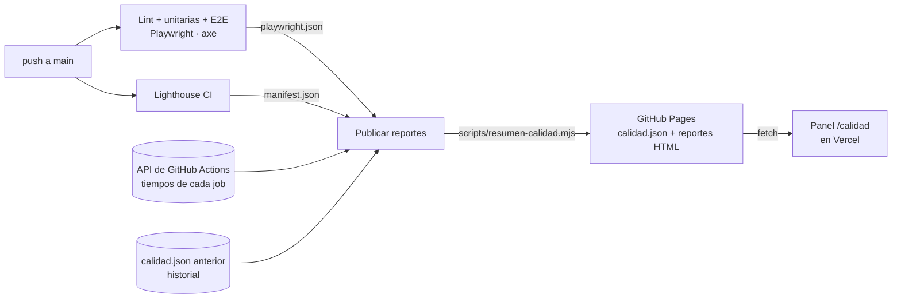

# Juan Macias — Portafolio QA

[](https://github.com/JuanMacias05/Mi-app-en-react-/actions/workflows/tests.yml)

Portafolio personal de **QA Automation Engineer / SDET**, en español e inglés.

**🌐 Sitio:** https://mi-app-en-react.vercel.app/
**📈 Panel de calidad:** https://mi-app-en-react.vercel.app/calidad (resultados reales del último run del CI)
**📊 Reportes completos:** https://juanmacias05.github.io/Mi-app-en-react-/ (Playwright + Lighthouse)

Lo construí y lo pruebo con el mismo criterio que aplico en el trabajo: cada pull request pasa por lint, pruebas unitarias, pruebas end-to-end, una auditoría de accesibilidad y Lighthouse antes de llegar a producción. Los resultados son públicos.

## Panel de calidad

`/calidad` es una página del propio sitio que muestra la última corrida del pipeline en `main`:

- **Estado general** y datos del run: número, commit, rama y enlace a GitHub Actions.
- **Resumen de pruebas E2E**: cuántas pasaron, fallaron o fueron *flaky* (pasaron solo al reintentar) y cuánto tardó la suite.
- **Lighthouse**: puntaje de cada categoría contra el mínimo definido en `lighthouserc.json`.
- **Línea de tiempo del pipeline**: cuánto tardó cada job y cada paso, y cuáles corrieron en paralelo.
- **Resultados por prueba**: filtros (todas, fallidas, flaky), búsqueda, el error de cada fallo y un enlace a esa prueba en el reporte de Playwright.
- **Historial** de las últimas 30 corridas: duración, estado, flaky y puntaje de accesibilidad.

Nada está escrito a mano: el panel lee `calidad.json`, que genera el CI en cada push a `main`.



El job de publicación corre aunque algo haya fallado: un panel que solo muestra corridas en verde no sirve para nada.

## Stack

- **Frontend:** React 19 + Vite, CSS sin frameworks
- **Contacto:** EmailJS
- **Pruebas:** Playwright (escritorio y móvil) + axe-core para accesibilidad + `node:test` para el generador del panel
- **Rendimiento y buenas prácticas:** Lighthouse CI
- **CI/CD:** GitHub Actions + Vercel

## Qué se prueba

| Archivo | Cobertura |
| --- | --- |
| `tests/contacto.spec.js` | Validación del formulario, envío correcto y manejo de errores (la API de EmailJS se intercepta) |
| `tests/cv.spec.js` | Descarga del CV en el idioma activo |
| `tests/idioma-tema.spec.js` | Cambio de idioma y de tema, y que se recuerden al recargar |
| `tests/navegacion.spec.js` | Menú, anclas y menú hamburguesa en móvil |
| `tests/accesibilidad.spec.js` | Reglas WCAG 2.1 A/AA con axe en ambos idiomas, ambos temas, el formulario con errores y el menú móvil |
| `tests/panel-calidad.spec.js` | Panel de calidad: resumen, filtros y búsqueda, enlaces al reporte, error de carga con reintento, formato desconocido, idioma, móvil y axe. Usa `tests/fixtures/calidad.json` (datos de prueba con un fallo y un flaky) en lugar de la red |
| `scripts/calidad/resumen.test.mjs` | Pruebas unitarias del generador de `calidad.json`: conteo de estados, limpieza de errores, mínimos de Lighthouse, línea de tiempo, historial sin duplicados y con tope |

### Umbrales de Lighthouse

Definidos en `lighthouserc.json`. Si una categoría baja del mínimo, el pipeline falla (rendimiento solo avisa, porque varía entre corridas).

| Categoría | Mínimo |
| --- | --- |
| Accesibilidad | 95 |
| Buenas prácticas | 90 |
| SEO | 90 |
| Rendimiento | 90 (aviso) |

## Correr el proyecto

```bash
npm install
cp .env.example .env.local   # llena los valores de EmailJS
npm run dev
```

## Correr las pruebas

```bash
npx playwright install chromium   # solo la primera vez
npm test             # toda la suite E2E
npm run test:unit    # pruebas unitarias del generador del panel
npm run test:ui      # modo interactivo
npm run test:report  # abre el último reporte HTML
npm run lighthouse   # build + auditoría Lighthouse (reporte en lighthouse-report/)
```

Las pruebas usan la versión de producción (`build` + `preview`), igual a la que publica Vercel.

### Ver el panel con tus resultados locales

```bash
npm test && npm run lighthouse     # genera resultados/playwright.json y lighthouse-report/
npm run calidad:local              # escribe public/calidad.json
echo "VITE_CALIDAD_URL=/calidad.json" >> .env.local
npm run dev                        # abre http://localhost:5173/calidad
```

En local no hay línea de tiempo del pipeline ni enlaces al run: esos datos solo existen dentro de GitHub Actions.

## Variables de entorno

| Variable | Descripción |
| --- | --- |
| `VITE_EMAILJS_SERVICE_ID` | ID del servicio de EmailJS |
| `VITE_EMAILJS_TEMPLATE_ID` | ID de la plantilla de EmailJS |
| `VITE_EMAILJS_PUBLIC_KEY` | Llave pública de EmailJS |
| `VITE_CALIDAD_URL` | Opcional. De dónde lee el panel `calidad.json` (por defecto, GitHub Pages) |

En producción se configuran en Vercel. En CI se usan valores ficticios porque las pruebas nunca envían correos reales.

## Estructura

```
src/
  components/   Secciones del sitio
  data/         Contenido en español e inglés (editar aquí, no en los componentes)
  i18n/         Cambio de idioma
  hooks/        Tema claro/oscuro
  quality/      Panel de calidad (/calidad), se carga aparte
scripts/
  resumen-calidad.mjs   Genera calidad.json en el CI
  calidad/              Lógica del generador y sus pruebas unitarias
tests/          Pruebas Playwright (fixtures/ y helpers/ incluidos)
```
